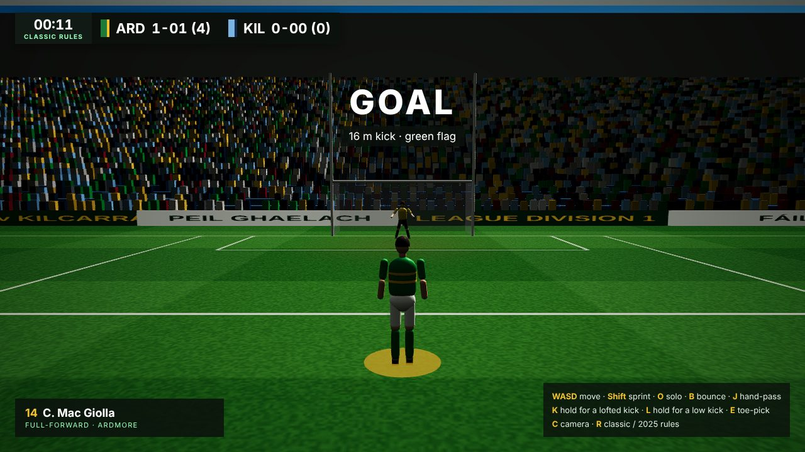

# GAALETSGO

A third-person Gaelic football game for the browser, built with Vite, TypeScript, Babylon.js and Havok physics.



This is the first playable slice: one Ardmore player on a full-size pitch who can run, carry, bounce, solo, toe-pick, kick and hand-pass, with the rules engine calling steps, double bounces, pick-ups and scores. Everyone else stands in formation until team AI arrives.

## Demo

A playable build is published at https://claude.ai/artifact/8tKmfvyRtA6bvKdEBbSh4M (private to the owner). `npm run build:demo` produces the single-bundle version in `dist-demo/`.

## Run it

```sh
npm install
npm run dev      # http://localhost:5173
npm test         # rules engine unit tests
npm run build    # production build in dist/
```

Add `?rules=2025` to the URL to start with the 2025 rules, or press **R** in game to switch.

## Controls

| Key | Action |
| --- | --- |
| WASD | Move (relative to the camera) |
| Shift | Sprint |
| O | Solo (resets the step count) |
| Q | Auto-solo on/off: the player solos by themselves on the 4th step |
| B | Bounce (resets the step count, not twice in a row) |
| J | Hand-pass |
| K (hold) | Lofted kick, hold longer for more power |
| L (hold) | Low drilled kick, for goal shots |
| E | Toe-pick a ball on the ground into your hands (within about 2 m; press it just before you reach the ball) |
| G | Pick up with the hands (a foul, to show the rule) |
| Mouse drag | Pan the camera (finger drag on the pitch on touch screens) |
| Mouse wheel | Zoom the camera |
| V | Reset the camera view |
| C | Switch between the behind-the-player and broadcast cameras |
| R | Switch between classic and 2025 rules |
| F12 | New game (scores and clock reset). Some browsers also open developer tools on F12 |
| Click or tap the pitch | Turn to face that spot (aims kicks and passes) |

### Xbox controller

Plug in or pair a controller and press any button; the help panel switches to the controller layout.

| Button | Action |
| --- | --- |
| Left stick / d-pad | Move |
| Right stick | Look around; the camera goes back behind the player when you let go |
| RB or left stick click | Sprint |
| A | Hand-pass |
| B or RT | Solo (drop the ball onto the toe and back to the hands) |
| LT | Bounce |
| X, ball on the grass | Toe-pick |
| X (hold), ball in hand | Kick: the bar fills for height and distance, the left stick left or right curls it, and a line shows where it will land |
| Y (hold) | Lofted kick |
| View | Switch camera |
| LB | Reset camera view |
| Right stick click | Switch rules |
| Menu | New game |

On phones and tablets an on-screen stick and buttons appear. Push the stick to the edge to sprint.

## Rules

Rule sets live in `src/rules/ruleSets.ts`:

- **Classic**: 4 steps, goals 3, points 1. Hand-passed goals are not allowed; hand-passed points are.
- **2025 rules** (option): adds the 40 m two-point arc for kicked points, kick-outs past the arc, 3 up and 4 back, and 50 m free advances. These values still need checking against the current GAA Official Guide.

Scores are shown as goals-points (total), for example `2-12 (18)`.

## Layout

```
src/
  rules/   pure TypeScript rules engine (rule sets, scoring, carry tracking), unit tested
  scene/   pitch and markings, stadium and crowd, H-posts, greybox players, lighting
  game/    ball (Havok body + air drag), input, HUD, and the match slice
tests/     Vitest tests for the rules engine
```
